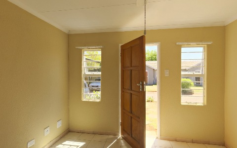

# A 360° panorama to 3D Gaussians

Reconstruct an equirectangular RGB panorama with InfiniSplat v2. The command
projects the panorama into 24 calibrated perspective views and jointly predicts
a native Gaussian scene, including learned scale, rotation, appearance and opacity.

## Install

Follow [INSTALL.md](../INSTALL.md) for CUDA PyTorch, the pinned DA3 package and
weights. Then, from `InfiniSplat_v2/`:

```bash
pip install '.[panorama]'
npm install --prefix .tools/splat @playcanvas/splat-transform@2.6.0
export PATH="$PWD/.tools/splat/node_modules/.bin:$PATH"
```

## Included example: small_empty_house



*Screenshot of the generated standalone Gaussian viewer.*

The input JPEG is included in the repository (about 3.1 MB); no dataset download
is needed. Run from `InfiniSplat_v2/`:

```bash
infinisplat-panorama \
  --input examples/panorama/small_empty_house.jpg \
  --model Edisoneh/InfiniSplat-v2 \
  --long-side 768 \
  --output result_small_empty_house
```

Alternatively use `--model weights/da3` with the downloaded v2 bundle.
The model ID downloads the public weights on first use. The output directory must
be new. Open `result_small_empty_house/scene.html` in a WebGL2-capable browser.
The viewer starts at the panorama capture center; it can also be downloaded and
opened locally. HTML is standalone SH0, generated with `splat-transform -H 0`.

Use `--input /path/to/your_panorama.jpg` for your own scene. Inputs must be full
360° × 180° equirectangular RGB images with approximately 2:1 aspect ratio, no
EXIF rotation, at most 128 megapixels and below 32767 pixels per edge. Ordinary
perspective photos, raw fisheye photos, HDR/EXR radiance maps and partial panoramas
are not supported by this command. Tone-map HDR imagery to RGB JPEG/PNG first.

`--long-side 768` becomes **770 × 770** per view to match the 14-pixel model grid.
All 24 views are retained. This is a demanding GPU workload; for a first smoke
test or an out-of-memory error, try `--long-side 224`, then `518`. Lower resolution
reduces detail. `--device cuda:1` selects a GPU. `--no-html` skips the optional
converter and writes the native Gaussian PLY. If HTML conversion fails, the PLY is
retained; do not rerun into the same output directory.

## Outputs and cameras

- `scene.ply`: native learned 3D Gaussians, without an export count cap.
- `scene.html`: standalone SH0 Gaussian viewer, unless `--no-html` is used.
- `cameras.npz`: effective OpenCV camera-to-world poses and pixel intrinsics.
- `input_cameras.npz` and `template.json`: fixed input calibration and view order.
- `contact_sheet.jpg`: the 24 perspective inputs.
- `result.json`: input hashes, camera/normalization contract, model identity,
  Gaussian statistics and output checksums.

The template uses eight yaw directions (0° through 315°, spaced by 45°), with
pitch rows ordered **0°, −45°, +45°**, and a 60° horizontal/vertical field of view.
Yaw zero looks at the panorama's horizontal center; positive yaw turns right and
positive pitch looks up. Adjacent views overlap. The template does not cover the
polar caps: the zenith and nadir can have holes.

All cameras share one center. The model receives the exact rotations and
intrinsics, with no camera prediction prepass or baseline scale fit. Depth keeps
the released model's predicted-point-radius normalization. Gaussian geometry and
camera poses use the first-camera-relative frame; global metric scale cannot be
recovered from a single panorama. Viewing from the capture center is the most
reliable use; translating into unseen regions can expose holes or stretched
geometry. This is an interactive reconstruction, not a metric 3D scan.

## Acknowledgements

This panorama-to-3DGS workflow was inspired by
[Enndee](https://github.com/Enndee) and
[SHARP_360_to_Splat](https://github.com/Enndee/SHARP_360_to_Splat).
Thank you for the inspiration!

The included [small_empty_house](https://polyhaven.com/a/small_empty_house)
panorama is from Poly Haven, released under CC0. See the
[example attribution](../examples/panorama/NOTICE.md).
